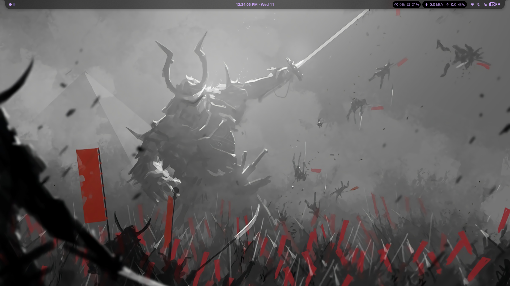
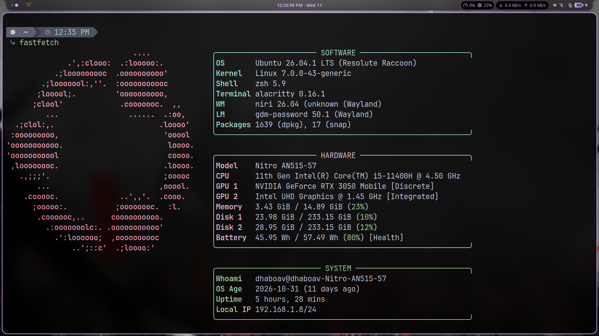

# Dotfiles

My personal Linux configuration and setup repository, featuring application configurations, installation scripts, and system automation.

Tested on **Ubuntu 26.04.1 LTS** with **Linux kernel 7.0.0-43-generic**. Configurations are tailored to this environment and may require adjustments on other systems.

## Preview

| Desktop — Niri + Noctalia | Terminal |
|:---:|:---:|
|  |  |

## Installation

Clone the repository:

```bash
git clone https://github.com/dhaboav/.dotfiles.git
cd .dotfiles
```

Run the setup script:

```bash
chmod +x dotshell.sh
./dotshell.sh
```

View available commands:
```bash
./dotshell.sh --help
```
## Structure

```text
├── assets/       # Screenshots and assets
├── config/       # Custom configurations to use or adapt
├── lib/          # Shared utilities and styles
├── packages/     # Package installation scripts
├── scripts/      # Additional scripts
└── dotshell.sh   # Main CLI   
```
## Dotshell

A lightweight, modular Bash CLI for managing applications and their configurations.

- Install and uninstall packages.
- Check package status.
- Manage custom application configurations and symlinks.
- Extend functionality through independent package scripts.

## Disclaimer

> This repository is intended for personal use. Review scripts and back up existing configurations before running them. Some operations may require administrator privileges or modify system settings.
