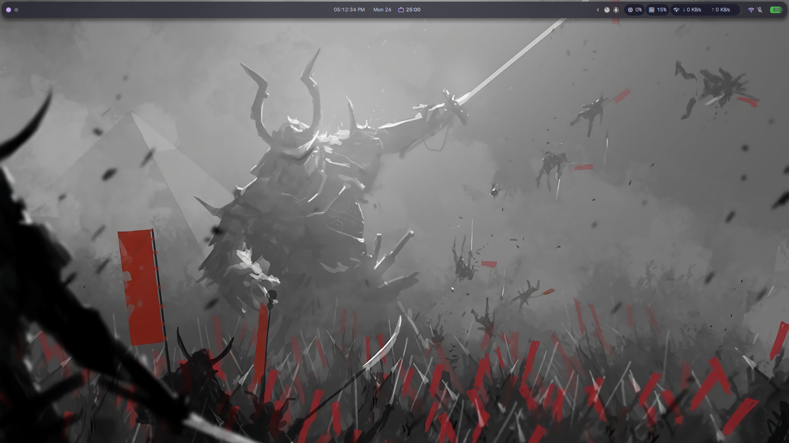
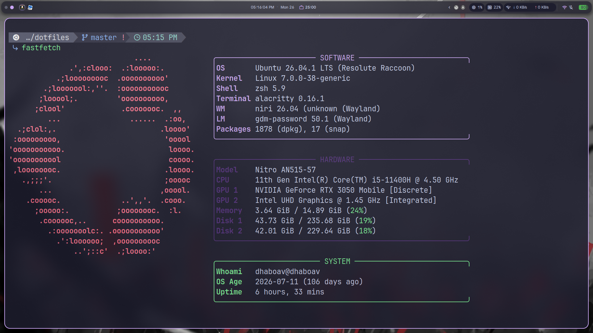

# Dotfiles

Automated setup scripts and configuration files for an Ubuntu-based Linux environment.

## Compatibility

Tested on **Ubuntu 26.04.1 LTS (Resolute Raccoon)** with kernel **Linux 7.0.0-38-generic**.

This setup is tailored to my environment and may require adjustments on other Ubuntu releases, Linux distributions, or kernel versions. Review the scripts and configurations before running them.

## Showcase

|       Desktop (Niri + DMS)       |  Terminal (Fastfetch + Starship)   |
| :------------------------------: | :--------------------------------: |
|  |  |

## Components

### 1. Core Environment

Run `scripts/install_zsh.sh` to set up the terminal environment:

- Zsh and Starship
- Nerd Fonts
- Zsh plugins
- Configuration symlinks

**Optional:** Install Fastfetch and apply the provided configuration using a symlink.

### 2. Desktop Environment (Optional)

To replicate my desktop setup, install [DMS](https://duxlabs.dev/docs/getting-started), Niri, and Alacritty by following the official installation instructions.

Apply the provided Niri and Alacritty configurations, then restore the DMS configuration backup:

```bash
dms restore dms-backup-config
```

### 3. ROS 2 (Optional)

Use the provided scripts to automate ROS 2 installation, workspace setup, or uninstallation.

## Getting Started

Clone the repository and run the core setup:

```bash
git clone https://github.com/dhaboav/dotfiles.git
cd dotfiles

chmod +x scripts/*.sh
./scripts/install_zsh.sh
```

Review scripts before running them. Log out and back in if required for shell changes to take effect.

## Repository Structure

```text
.
├── assets/     # Screenshots and other assets
├── config/     # Application configurations (~/.config/)
├── home/       # Home-directory configurations (~/)
└── scripts/    # Installation and setup scripts
```

## Available Scripts

| Script              | Description                                                       |
| ------------------- | ----------------------------------------------------------------- |
| `install_zsh.sh`    | Install and configure Zsh, Starship, plugins, and symlinks (Main) |
| `install_font.sh`   | Install Nerd Fonts                                                |
| `setup_plugins.sh`  | Clone and manage Zsh plugins                                      |
| `install_ros2.sh`   | Install ROS 2 and initialize the workspace (standalone)           |
| `uninstall_ros2.sh` | Uninstall ROS 2 packages and dependencies (standalone)            |

> Note for install_font.sh && setup_plugins.sh are included in install_zsh.sh
